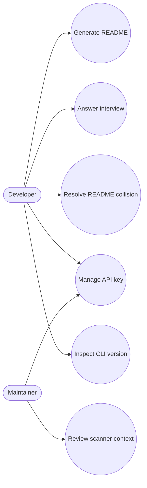

# System Requirements Specification (SRS)

**Project:** Ichiran  
**Version:** 0.1.0  
**SDLC model:** V-Model  
**Authors:** Utkarsh Kamat and Hruday  
**Status:** Academic project specification

## 1. Introduction

### 1.1 Purpose

This SRS defines the requirements for Ichiran, a local Python CLI that interviews a developer, scans a project for useful text files, sends selected context to Google Gemini, and creates a README.md in the current project directory.

### 1.2 Scope

Ichiran supports project discovery and README authoring. It does not host projects, publish documentation, or provide an offline language model. The user controls project-directory access, reviews Gemini-generated output, and supplies a Gemini API key.

### 1.3 Users and operating environment

- **Solo developer:** wants to produce or improve a README from a local codebase.
- **Student or project team:** needs consistent project documentation and a repeatable workflow.
- **Maintainer:** reviews generated documentation, rotates the Gemini credential, or contributes code.

The application targets Python 3.12 or newer on Windows, Linux, and macOS. A working internet connection and a valid Gemini API key are required for generation.

### 1.4 Use cases

## 2. Functional requirements

| ID | Requirement |
|---|---|
| FR-1 | The CLI shall expose `ichiran`, `ichiran --version`, and `ichiran --reset` entry points. |
| FR-2 | The application shall load the Gemini API key from its user config JSON, fall back to `API_KEY`, and prompt when neither provides a key. |
| FR-3 | The interview shall offer a five-question initial phase and optional usage/configuration and security/deployment/documentation phases. |
| FR-4 | Interview prompts shall support SKIP, TLDR, RTFM, and QUIT controls; a confirmed quit shall cancel README generation. |
| FR-5 | The scanner shall produce a project file tree and collect whitelisted text files while applying built-in exclusions and `.gitignore` rules. |
| FR-6 | The scanner shall exclude binary files, secret-oriented names such as `.env` and `.env.*`, unsupported file types, and files over the per-file size limit. |
| FR-7 | The scanner shall prioritize key project files and cap formatted codebase context at `MAX_TOTAL_CHARS`. |
| FR-8 | The application shall combine interview responses and scanned context into a request to Gemini 2.5 Flash. |
| FR-9 | The Gemini client shall retry 429 rate-limit errors with exponential backoff and propagate non-rate-limit client errors. |
| FR-10 | The writer shall clean common Markdown response fences and create a README.md when none exists. |
| FR-11 | When README.md exists, the writer shall support overwrite, append, and cancel; invalid choices shall leave the file unchanged. |
| FR-12 | The user shall be able to run the CLI without any automated test making a live Gemini request or modifying the real user config. |

## 3. Non-functional requirements

| ID | Requirement |
|---|---|
| NFR-1 | Local scanning and formatting shall remain bounded by configured per-file and total-context limits; generation latency is dominated by the external Gemini service. |
| NFR-2 | The scanner shall limit individual file size and avoid loading arbitrary binary assets; memory use may grow with the number of eligible files, while serialized prompt context remains capped. |
| NFR-3 | Path handling and terminal execution shall support Windows, Linux, and macOS. |
| NFR-4 | Recoverable user choices and rate limits shall produce clear terminal feedback; non-rate-limit API failures shall not be disguised as success. |
| NFR-5 | API keys and private project files shall not be intentionally included in the generated prompt; users shall be warned that scanning and external AI processing require review. |
| NFR-6 | Modules shall retain testable boundaries, packaging metadata, and tests that mock terminal input, filesystem destinations, and Gemini API calls. |

## 4. External interfaces and constraints

- **User interface:** Rich terminal output and standard input.
- **Filesystem:** current working directory for scanning and README creation; user config directory for credentials.
- **External service:** Google Gemini through `google-genai`; no inbound network listener.
- **Packaging:** Python project metadata in `pyproject.toml`; command entry point `ichiran = "cli:main"`.
- **Constraint:** Gemini API key and network access are required for a real generation.

## 5. Acceptance criteria

1. `ichiran --version` prints installed package metadata or the documented local fallback.
2. Tests can run without interactive terminal input or external Gemini access.
3. Scanner tests demonstrate ignore, whitelist, binary, file-size, and total-character limits.
4. Writer tests demonstrate all three collision choices.
5. The full Pytest suite meets the project coverage threshold of at least 85%.
6. Editable installation provides the `ichiran` command and importable flat modules.
