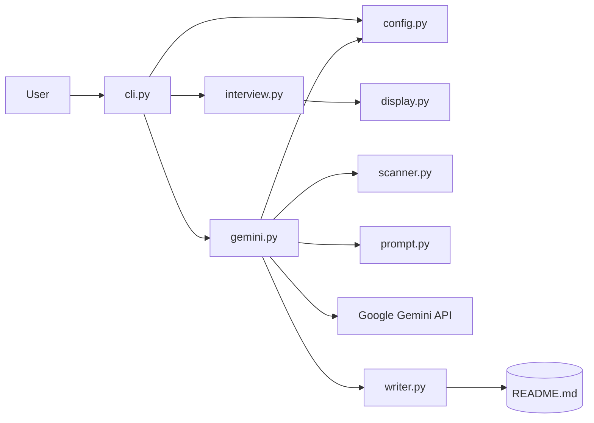
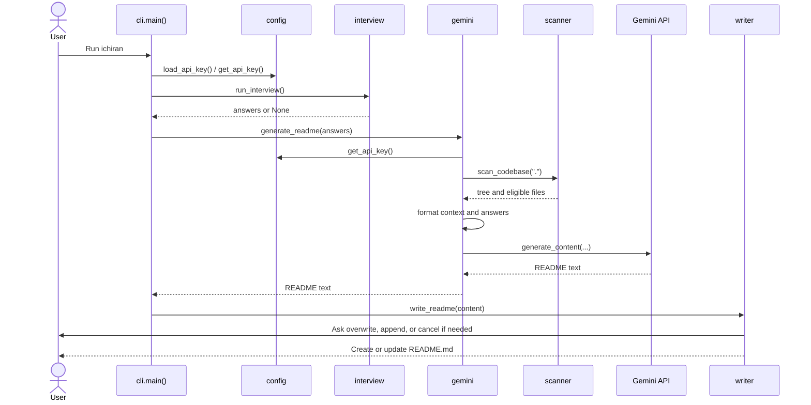

# System Design Document (SDD)

**Project:** Ichiran 0.1.0  
**Authors:** Utkarsh Kamat and Hruday

## 1. Architecture overview

Ichiran is a single-process, modular Python CLI. Components communicate through Python function calls and ordinary return values. The one remote boundary is the outbound request made through the Google GenAI SDK.

## 2. Components and responsibilities

| Component | Responsibility and public contract |
|---|---|
| `cli.py` | `main()` parses flags and orchestrates config, interview, generation, and writing. |
| `config.py` | `load_api_key()`, `save_api_key()`, `get_api_key()`, and `reset_api_key()` provide credential lifecycle operations. |
| `display.py` | Rich-based terminal rendering helpers; imported throughout the application. |
| `interview.py` | Runs phased question groups, parses controls, returns an answer dictionary or `None` for confirmed cancellation, and formats answers. |
| `scanner.py` | `scan_codebase(root)` returns `{"tree": list[str], "files": dict[str, str]}`; `format_codebase_for_prompt(...)` serializes bounded context. |
| `gemini.py` | `generate_readme(answers)` assembles context and invokes Gemini; `_call_with_retry(client, prompt, retries=3)` handles 429 errors. |
| `prompt.py` | Supplies the system instruction string used for README generation. |
| `writer.py` | `write_readme(content, directory=".")` cleans generated Markdown and resolves output collisions. |

### Packaging and module layout

The project intentionally uses a flat-module layout, configured by setuptools `py-modules`. The console script references `cli:main`. `__init__.py` is retained in the repository; the installed CLI imports the listed flat modules.

## 3. Sequence: CLI launch to README creation

## 4. Design decisions

1. **User-level API key configuration:** supports use across multiple working directories without creating a project-local credential file by default.
2. **Progressive interview:** a short initial set can produce a draft; users opt into additional detail.
3. **Allowlist plus ignore rules:** limits scanned content to relevant text files and excludes common generated or sensitive files.
4. **Priority file collection:** key entry points and manifests are ordered before other context.
5. **Explicit README collision prompt:** preserves existing documentation unless the user chooses a write action.
6. **Mockable external boundary:** tests replace the GenAI client and never need a live credential or network request.

## 5. Error and security boundaries

Rate-limit errors are retried; other `ClientError` instances propagate to the caller. The config JSON stores the key as plaintext and depends on host-user filesystem protections. The scanner's file filters reduce exposure but do not replace user review: eligible text may still contain secrets or private information. Gemini receives the assembled context over the SDK's external service boundary.
